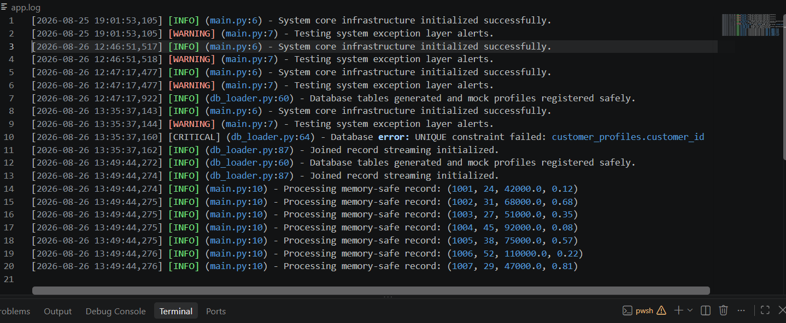
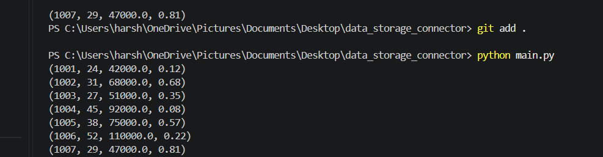

# MemStream-DB 🚀
### Fault-Tolerant Low-Memory Relational Data Streamer

**Tech Stack:** Python · SQL/SQLite · Generators · Logging · Git

---

## 📝 Problem Statement
In production data pipelines, applications frequently need to process large numbers of complex database records. Standard data pipelines utilize monolithic array loading arrays (such as `.fetchall()` or global data frame reads) that force the entire payload into system memory at once. As datasets grow to millions of rows, this approach triggers fatal **OutOfMemory (RAM Explosion) exceptions**, crashing host instances and escalating infrastructure costs.

**MemStream-DB** resolves this vulnerability by providing a memory-isolated, highly resilient relational data pipeline. It streams stitched transactional and demographic records row-by-row, keeping memory usage bounded by processing database records in controlled batches instead of loading the entire result set into memory.

---

## 🛠️ Technical Stack
* **Core Language:** Python 
* **Data Processing:** Generators, `yield`, `.fetchmany()` pagination
* **Storage Engine:** SQL / SQLite3
* **Production Observability:** Native Python `logging` Core (FileHandler)
* **Error Mitigation:** `try-except-finally` structures, atomic transaction `rollback()`
* **Version Control:** Git / GitHub

---

## 📐 System Architecture & Directory Layout
The project follows the **Separation of Concerns (SoC)** principle, completely isolating logging metrics, database schemas, streaming logic, and application managers into dedicated structural components:

```text
data_storage_connector/
│
├── data/
│   └── warehouse.db         # Persistent Relational Storage (Excluded from Git)
│
├── docs/
│   └── screenshots/
│       ├── app-log-output.png  # Verifiable app.log verification trace
│       └── terminal-output.png # Verifiable terminal execution trace
│
├── src/
│   ├── __init__.py          # Package Initialization Profile
│   ├── logger.py            # Module 1: Central Observability Engine
│   └── db_loader.py         # Modules 2 & 3: Database Schemas & Batch Streaming Core
│
├── main.py                  # Module 4: Application Entry Point & Manager
└── .gitignore               # Strict Corporate Git Exclusion Filters
```

---

## ⚙️ Key Engineering Optimizations & Implementations

### 1. Memory-Safe Batch Data Streaming
Instead of using memory-expensive `.fetchall()` calls, the pipeline uses `.fetchmany(chunk_size)` to retrieve records in highly controlled batches. Python generators utilizing the `yield` keyword then deliver individual records incrementally to the caller, isolating the active memory graph from horizontal data scale.

### 2. Analytical SQL Joining
Stitches isolated entity features (`customer_profiles` and `customer_behavior`) on the fly uses an `SQL INNER JOIN` to combine customer profile and behavior data at query time filters on matching relational primary keys (`customer_id`). Joined records are queried directly from the relational database structure before being streamed to the processing engine.

### 3. Defensive Transaction Safety (`rollback()`)
Database connections are protected with robust `try-except-finally` code blocks. If a SQLite error occurs during transaction states, the pipeline automatically calls **`rollback()`** to protect database metadata from corruption, writes a `CRITICAL` alert through the centralized logger, and closes the connection cleanly in the `finally` layer.

### 4. Centralized Production Logging
Instead of relying on volatile, high-overhead `print()` statements for system tracking, the project implements a centralized file handler system. System events are written to `app.log` containing precise timestamps, severity markers (`INFO`, `WARNING`, `CRITICAL`), source filenames, and the exact lines of code where events occurred.

---

## 💻 How to Clone and Execute Locally

Clone the repository and verify pipeline stability locally using these native terminal commands:

```powershell
# 1. Clone the repository infrastructure
git clone []

# 2. Navigate to the project directory
cd data_storage_connector

# 3. Run the application entry point
python main.py
```

---

## 🔎 Verification & Production Outputs

### 1. Terminal Execution Trace
The streaming data conveyor belt handles row-by-row extraction dynamically across the local host system environment.


### 2. Persistent Production Audit Trail (`app.log`)
System operations, severity alerts, and resource allocation lifecycles are monitored seamlessly without human intervention.

